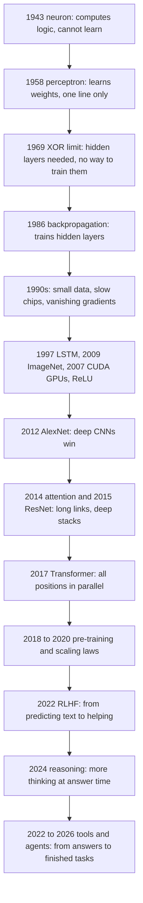

You type a question into a chat window. A few seconds later, a model answers in full paragraphs. It can also read your code, run a test, see that the test fails and fix the bug. None of this came from one invention. It came from a chain of about eighty years, where each step fixed a problem that the step before it left behind.

This refresher walks that chain. It starts with a 1943 paper that drew a brain cell as a logic switch, and ends with Anthropic's Claude Opus 5.5 in October 2026. It gives the key equation of each big step, with small numbers you can check by hand. Where a paper changed the field, you see the page itself, with the key words marked.

This part follows one line: neural networks, from a single artificial neuron to today's agents. A second line ran beside it: statistical methods such as regression, decision trees and boosting, which still win on many business problems. They have their own part, [Classical Machine Learning](classical-machine-learning.md). [Part 3](reinforcement-learning-history.md) follows learning from reward, and [Part 4](how-models-are-trained-today.md) shows how language models are trained today. [Part 5](inside-a-modern-language-model.md) opens the base model itself: its data, scale and architecture.

> [!TIP] The whole idea in one minute
> A machine that learns needs a **model** with knobs to turn, **data** that shows good answers, and **compute** to turn the knobs many times. Each era was stuck on one of the three. Backpropagation lacked data and speed; GPUs and ImageNet gave both, and the Transformer used that speed well. Pre-training gave knowledge, human feedback made it helpful, and tools made it an agent.

<figure class="fig"><svg viewBox="0 0 720 360" role="img" aria-label="A timeline of seven overlapping eras of neural network AI, from the first artificial neurons in 1943 to reasoning models and agents in 2026. The later eras are much shorter than the early ones."><text class="t-title" x="10" y="22">Seven eras on one axis, 1940 to 2026</text><line class="grid" x1="250" y1="34" x2="250" y2="322"/><line class="grid" x1="354" y1="34" x2="354" y2="322"/><line class="grid" x1="458" y1="34" x2="458" y2="322"/><line class="grid" x1="562" y1="34" x2="562" y2="322"/><line class="grid" x1="666" y1="34" x2="666" y2="322"/><text class="t-note" x="10" y="52">First neurons, the perceptron</text><text class="t-tick" x="10" y="68">1943 to 1969</text><rect class="box-1" x="266.6" y="42" width="128.6" height="22" rx="4"/><text class="t-note" x="10" y="92">Rules, expert systems, winters</text><text class="t-tick" x="10" y="108">1969 to early 1990s</text><rect class="box-4" x="400.8" y="82" width="124.8" height="22" rx="4"/><text class="t-note" x="10" y="132">Backprop, CNNs, RNNs, LSTMs</text><text class="t-tick" x="10" y="148">1982 to 2006</text><rect class="box-2" x="468.4" y="122" width="124.8" height="22" rx="4"/><text class="t-note" x="10" y="172">Deep learning on GPUs</text><text class="t-tick" x="10" y="188">2006 to 2017</text><rect class="box-1" x="593.2" y="162" width="57.2" height="22" rx="4"/><text class="t-note" x="10" y="212">Transformers, pre-training</text><text class="t-tick" x="10" y="228">2017 to 2022</text><rect class="box-2" x="650.4" y="202" width="26" height="22" rx="4"/><text class="t-note" x="10" y="252">Assistants, RLHF, open models</text><text class="t-tick" x="10" y="268">2022 to 2026</text><rect class="box-3" x="676.4" y="242" width="20.8" height="22" rx="4"/><text class="t-note" x="10" y="292">Reasoning models, agents</text><text class="t-tick" x="10" y="308">2024 to 2026</text><rect class="box-4" x="686.8" y="282" width="10.4" height="22" rx="4"/><line class="axis" x1="250" y1="324" x2="700" y2="324"/><text class="t-tick" x="238" y="344">1940</text><text class="t-tick" x="342" y="344">1960</text><text class="t-tick" x="446" y="344">1980</text><text class="t-tick" x="550" y="344">2000</text><text class="t-tick" x="654" y="344">2020</text></svg><figcaption>The eras overlap, and they get shorter. The first two lasted decades. The last three fit inside nine years.</figcaption></figure>

## 1943 to 1958: a brain cell drawn as a switch

### The McCulloch-Pitts neuron

A real brain cell, a **neuron**, has many thin branches that collect signals from other cells and one long fibre that sends a signal on. At the end of the 1800s, the Spanish scientist Santiago Ramón y Cajal stained brain tissue and drew these cells by hand. His drawings showed that the brain is a network of separate cells, not one continuous web.

<figure class="narrow"><figcaption>Neurons in three areas of the human cortex, drawn by Santiago Ramón y Cajal and published in 1899. Public domain, via Wikimedia Commons.</figcaption></figure>

Think of a light that turns on only when enough of its switches are pressed. In 1943, the neuroscientist Warren McCulloch and the logician Walter Pitts proposed that a brain cell works in a similar way. Their paper was "A Logical Calculus of the Ideas Immanent in Nervous Activity". It described a neuron as a unit that adds up its inputs and fires if the sum passes a threshold.

> [!DEFINITION] Artificial neuron
> A small unit of computation. It takes several numbers as input, combines them into one number, and gives an output. In the 1943 version the inputs and the output are only 0 or 1.

Their key result was that networks of these units can compute any logical function, such as AND, OR and NOT. This linked the brain to the new idea of a computing machine. It did not say how such a network could learn. Every connection had to be set by hand.

### Turing asks the question

In 1950, the British mathematician Alan Turing published "Computing Machinery and Intelligence". He replaced the question "Can machines think?" with the imitation game, now called the **Turing test**. A judge chats by text with a hidden human and a hidden machine; if the judge cannot tell which is which, the machine passes.

<figure class="narrow"><figcaption>A passport photo of Alan Turing at about 16, taken around 1928. Photographer possibly Arthur Reginald Chaffin. Public domain, via Wikimedia Commons.</figcaption></figure>

In a section on "learning machines", Turing suggested building a "child machine" and teaching it, instead of programming an adult mind. That is the idea this whole story follows.

### Dartmouth names the field

In the summer of 1956, a workshop at Dartmouth College gave the field its name. John McCarthy, Marvin Minsky, Nathaniel Rochester and Claude Shannon wrote the proposal on 31 August 1955. It is the first known use of the term "artificial intelligence".

> [!PAPER] McCarthy, Minsky, Rochester and Shannon (1955), A Proposal for the Dartmouth Summer Research Project on Artificial Intelligence · page 2
> 
>
> **What it says:** the authors propose a 2-month, 10-man study in the summer of 1956. It rests on one conjecture. "Every aspect of learning or any other feature of intelligence" can be described so precisely "that a machine can be made to simulate it".
>
> **What it means:**
>
> The proposal bet that intelligence can be described precisely, and a description can run on a machine. The same page lists "neuron nets" as one topic among several. For the next thirty years, most AI research tried to write those descriptions by hand, as symbols and logic.

### The perceptron learns its own weights

In 1958, the psychologist Frank Rosenblatt published the perceptron. It was a McCulloch-Pitts neuron with one big change: the strength of each connection was a number that the machine could adjust by itself. Rosenblatt then built it as hardware, the **Mark I Perceptron**, with US Navy funding. It learned to tell simple shapes apart from the pixels of a camera.

<figure><figcaption>The Mark I Perceptron, Figure 2 of its operator's manual (Hay and Murray, 15 February 1960, a report under a US Navy contract). The camera is the input. The racks hold the adjustable weights. Public domain, via Wikimedia Commons.</figcaption></figure>

> [!DEFINITION] Weight and bias
> A **weight** is a number that says how much one input matters. A large positive weight pushes the output up, a negative weight pushes it down. The **bias** is one extra number that shifts the threshold, so the neuron can fire more or less easily.

The perceptron works like a judge at a cooking contest who gives each dish a score for taste, look and smell. Each score gets multiplied by how much the judge cares about it. If the total passes a line, the dish wins.

$$
y = \begin{cases} 1 & \text{if } \sum_{i} w_i x_i + b > 0 \\ 0 & \text{otherwise} \end{cases}
$$

Here $$x_i$$ is the value of input number $$i$$, and $$w_i$$ is its weight. The sum $$\sum_i w_i x_i$$ multiplies each input by its weight and adds the results. The bias $$b$$ is added to that sum. The output $$y$$ is 1 when the total is above zero and 0 when it is not.

Take two inputs, $$w_1 = w_2 = 1$$ and $$b = -1.5$$. For the input $$(1, 1)$$ the total is $$1 + 1 - 1.5 = 0.5$$, so $$y = 1$$. For $$(1, 0)$$ the total is $$1 - 1.5 = -0.5$$, so $$y = 0$$. This perceptron computes AND: it fires only when both inputs are 1.

The new part was the learning rule. Show the perceptron an example with the correct answer $$t$$. If its answer $$y$$ is right, change nothing. If it is wrong, move each weight a little in the direction that would have helped.

$$
w_i \leftarrow w_i + \eta\,(t - y)\,x_i
$$

The arrow means "replace with". The symbol $$\eta$$ (eta) is the **learning rate**, a small number that sets the size of each step. The term $$(t - y)$$ is the error: it is $$+1$$ when the perceptron said 0 but should have said 1, and $$-1$$ in the opposite case. The bias gets the same update with $$x_i$$ replaced by 1.

Start with all weights and the bias at 0, and $$\eta = 1$$. Show the input $$(1, 1)$$ with target $$t = 1$$. The total is 0, which is not above 0, so $$y = 0$$ and the error is $$+1$$. Both weights become 1 and the bias becomes 1. The next time it sees $$(1, 1)$$, the total is 3 and the answer is right.

Rosenblatt proved that if a straight line can separate the two classes, this rule always finds one in a finite number of steps. That is the perceptron convergence theorem. The press was excited, and so were the funders. The trouble was hidden in the word "if".

## 1966 to the early 1990s: a chatbot, a limit and two winters

### ELIZA, an early chatbot

In 1966, Joseph Weizenbaum at MIT published **ELIZA**, a program that held a typed conversation. Its best-known script, DOCTOR, played a therapist. It matched keywords in the user's sentence and turned them into questions. "I am unhappy" might come back as "Can you explain what made you unhappy?". There was no understanding and no learning, only patterns written by hand.

<figure><figcaption>A conversation with a modern reimplementation of ELIZA (Norbert Landsteiner, 2005), using the opening lines from Weizenbaum's 1966 paper. Public domain, via Wikimedia Commons.</figcaption></figure>

People still felt understood, which disturbed Weizenbaum. ELIZA showed early that fluent text and real understanding are different things.

### The XOR problem

Draw the four inputs of a two-input function as the corners of a square. For AND, only the corner $$(1, 1)$$ is "yes", and one straight line cuts it off from the other three. Now take XOR, "one or the other, but not both". The "yes" corners are $$(1, 0)$$ and $$(0, 1)$$, which sit on opposite corners. No single straight line can separate them from $$(0, 0)$$ and $$(1, 1)$$.

> [!DEFINITION] Linearly separable
> A set of examples is linearly separable when one straight line can split them. All the "yes" examples fall on one side and all the "no" examples on the other. In more dimensions, the line becomes a flat plane.

A single perceptron draws exactly one line, so it cannot learn XOR. In 1969, Marvin Minsky and Seymour Papert published the book *Perceptrons*. They proved this limit and several deeper ones with care. They knew that networks with more layers could compute XOR. The problem was that nobody had a good way to train the hidden layers in the middle.

> [!DEFINITION] Hidden layer
> A layer of neurons between the input and the output. Its values are not given by the data and not seen in the answer. The network must find useful values for them by itself.

Funding for neural network research dried up for more than a decade. The book was not the only cause, but it became the symbol of the moment the first wave stopped.

### The first AI winter

Symbolic AI had its own troubles. Its programs did well in small, clean worlds and broke in the messy real one. In 1973, the Lighthill report to the British government judged that AI had not met its goals. Funding in the United Kingdom was cut hard, and the US agency DARPA also reduced its support. Such a period of falling money and interest is called an **AI winter**.

### Expert systems and the second winter

AI came back in the late 1970s and 1980s as **expert systems**. The idea was to interview human experts and write their knowledge as hundreds or thousands of IF-THEN rules. MYCIN, built at Stanford in the 1970s, suggested antibiotics for blood infections. XCON, used by Digital Equipment Corporation from about 1980, configured computer orders. Companies built special "Lisp machines" to run such programs.

> [!DEFINITION] Expert system
> A program that makes decisions from a large set of rules written by people. An example rule: "IF the infection is in the blood AND the organism is rod-shaped THEN suggest drug X".

Expert systems worked in narrow areas, but every new case needed a new rule written by hand. When cheaper desktop computers made Lisp machines unnecessary, that market collapsed around 1987, and a second winter followed.

The lesson of this era is the root of everything that came after. Writing intelligence down by hand does not scale. The machine must learn the rules from examples.

## 1982 to 1989: neural networks learn again

### Hopfield networks and Boltzmann machines

Neural networks came back through physics. In 1982, the physicist John Hopfield showed that a network of connected neurons can store patterns as stable states, like dips in a landscape. Give it a damaged or partial pattern, and the network settles into the nearest stored one. It works like recalling a whole song from its first three notes.

> [!DEFINITION] Hopfield network
> A network in which every neuron connects to every other neuron. Its weights store a set of patterns. Started from a noisy input, it updates its neurons until it settles on the closest stored pattern.

<figure class="narrow"><figcaption>A Hopfield network with four neurons. Every output feeds back into every other neuron. Diagram by Deditos, CC BY-SA 3.0, via Wikimedia Commons.</figcaption></figure>

In 1985, David Ackley, Geoffrey Hinton and Terrence Sejnowski published the **Boltzmann machine**. It is a random version of the same idea, and it learns the patterns in its data. Both models were slow, but they brought new ideas from physics into the field.

### The loss and the downhill step

Training a network needs two ideas, and every later model in this story uses both.

> [!DEFINITION] Loss function
> A number that measures how wrong a model is on its data. An example is the sum of the squared differences between its answers and the true answers. Training a model means making its loss small.

> [!DEFINITION] Gradient descent
> A way to make a loss small step by step. At the current weights, find the direction in which the loss goes up the fastest (the **gradient**), and take a small step the opposite way. Repeat many times.

It is like walking down a hill in thick fog. You cannot see the valley, but you can feel the slope under your feet. Each step goes downhill. In symbols, for one weight:

$$
w \leftarrow w - \eta \, \frac{\partial L}{\partial w}
$$

$$L$$ is the loss. $$\frac{\partial L}{\partial w}$$ is its **derivative**: how much the loss changes when $$w$$ changes a tiny amount. The learning rate $$\eta$$ sets the step size. If the derivative is positive, the update lowers $$w$$; if it is negative, the update raises $$w$$.

> [!DEFINITION] Overfitting
> When a model learns the noise and quirks of its training examples instead of the real pattern. It then scores well on the examples it saw and badly on new ones.

### Backpropagation, 1986

A network with hidden layers can compute XOR. To train it with gradient descent, you need the derivative of the loss with respect to every weight, even deep inside the network.

The math for it had appeared earlier. Seppo Linnainmaa described reverse-mode automatic differentiation in his 1970 master's thesis, and Paul Werbos proposed using it for neural networks in his 1974 PhD thesis. The method spread in 1986, when David Rumelhart, Geoffrey Hinton and Ronald Williams published "Learning representations by back-propagating errors" in *Nature*. They showed that hidden layers learn useful internal features by themselves.

> [!DEFINITION] Backpropagation
> An algorithm that computes the gradient of the loss with respect to every weight in a network. It runs the network forward to get the loss, then passes the error backward, layer by layer, using the chain rule of calculus.

### The chain rule, one link at a time

Think of a row of gears. Say gear A turns gear B twice as fast, and gear B turns gear C three times as fast. Then A turns C six times as fast. To know how a turn of the first gear affects the last one, you multiply the ratios along the way. The chain rule says the same thing about derivatives.

Take the smallest possible network. An input $$x$$ goes into a hidden value $$h = w_1 x$$. The hidden value goes into the output $$y = w_2 h$$. The loss compares the output with a target $$t$$: $$L = (y - t)^2$$. To find how the loss depends on the first weight, we multiply the local derivatives along the path:

$$
\frac{\partial L}{\partial w_1} = \frac{\partial L}{\partial y} \cdot \frac{\partial y}{\partial h} \cdot \frac{\partial h}{\partial w_1} = 2(y - t) \cdot w_2 \cdot x
$$

Read it from left to right. $$\frac{\partial L}{\partial y} = 2(y - t)$$ says how much the loss changes when the output changes. $$\frac{\partial y}{\partial h} = w_2$$ says how much the output changes when the hidden value changes. $$\frac{\partial h}{\partial w_1} = x$$ says how much the hidden value changes when the first weight changes. Multiply the three, as with the gears.

Now use numbers. Let $$x = 1$$, $$w_1 = 2$$, $$w_2 = 3$$ and $$t = 5$$. The forward pass gives $$h = 2$$, $$y = 6$$ and $$L = 1$$. The backward pass gives $$\frac{\partial L}{\partial w_1} = 2 \cdot 3 \cdot 1 = 6$$ and $$\frac{\partial L}{\partial w_2} = 2(y - t) \cdot h = 2 \cdot 2 = 4$$. With $$\eta = 0.05$$, the weights become $$w_1 = 1.7$$ and $$w_2 = 2.8$$. The new output is $$1.7 \times 2.8 = 4.76$$, and the loss drops from 1 to about 0.06.

The trick is reuse. The term $$2(y - t)$$ is computed once and shared by every weight behind it, so one backward pass costs about as much as one forward pass. Every model in this story still learns this way.

### What a deep network can represent

Each neuron in a modern network also applies a **nonlinear** function after its weighted sum. Without one, a stack of layers collapses into a single weighted sum, and depth would add nothing. The 1980s networks used the sigmoid, an S-shaped curve.

> [!DEFINITION] Activation function
> The nonlinear function a neuron applies to its weighted sum. The sigmoid squeezes any number into the range 0 to 1. The ReLU keeps positive numbers and turns negative ones into 0.

In 1989, George Cybenko, and separately Kurt Hornik, Maxwell Stinchcombe and Halbert White, proved the **universal approximation theorem**. A network with one hidden layer and enough neurons can approximate any continuous function as closely as you like. The theorem says such a network exists, not how to find it.

### LeNet reads handwritten digits

In 1989, Yann LeCun and colleagues at Bell Labs used backpropagation to read handwritten US zip codes. Their network did not look at the whole image at once. It slid small detectors across the image, a design called a **convolutional network**, which a later section explains. Its 1998 successor, LeNet-5, was used in systems that read the amounts on bank checks.

> [!PAPER] LeCun, Bottou, Bengio and Haffner (1998), Gradient-Based Learning Applied to Document Recognition · Fig. 2 · page 7
> 
>
> **What it says:** the "Architecture of LeNet-5, a Convolutional Neural Network, here for digits recognition". Each plane is a feature map, "a set of units whose weights are constrained to be identical".
>
> **What it means:**
>
> Read the figure from left to right. Convolution layers (C1, C3) find small patterns, and subsampling layers (S2, S4) shrink the maps. The last layers turn everything into ten outputs, one per digit. "Weights constrained to be identical" means one detector is reused at every position. AlexNet in 2012 kept this plan and made it much bigger.

## Sequences: recurrent networks and the LSTM

### A network with a memory

A sentence is a sequence. To understand "the bank by the river", you need to remember "river" when you reach the end. A plain neural network takes a fixed-size input and has no memory. A **recurrent neural network** reads one item at a time and carries a summary, its hidden state, from each step to the next. Jeffrey Elman's 1990 paper "Finding Structure in Time" made this simple form widely known.

> [!DEFINITION] Recurrent neural network (RNN)
> A network that processes a sequence one step at a time. At each step, it combines the new input with its own hidden state from the previous step, and outputs an updated hidden state.

It is like reading a book while keeping notes on a single index card. After each word, you rewrite the card from the old card and the new word.

$$
h_t = \tanh\big( W_h \, h_{t-1} + W_x \, x_t + b \big)
$$

$$x_t$$ is the input at step $$t$$, for example a word. $$h_{t-1}$$ is the hidden state from the step before, the old index card. $$W_h$$ and $$W_x$$ are weight matrices that the network learns, and $$b$$ is a bias. The function $$\tanh$$ squeezes every number into the range $$-1$$ to $$1$$. The result $$h_t$$ is the new hidden state. The same weights are used at every step.

### The vanishing gradient

To learn that "river" matters for "bank", the error at the end of the sentence must flow back through every step to the word "river". Backpropagation through time multiplies one factor per step. If that factor is smaller than 1, the product shrinks fast. Sepp Hochreiter analysed this in his 1991 thesis, and Yoshua Bengio, Patrice Simard and Paolo Frasconi showed it again in 1994.

> [!DEFINITION] Vanishing gradient
> When the gradient gets smaller and smaller as it flows back through many layers or time steps. In the end, the early ones get almost no learning signal.

If each step multiplies the gradient by 0.5, then after 20 steps the factor is $$0.5^{20}$$, about one in a million. A word twenty steps back has almost no effect on learning. The same problem hurt deep networks, with layers in place of time steps.

### The LSTM: a conveyor belt for memory

In 1997, Sepp Hochreiter and Jürgen Schmidhuber published the **Long Short-Term Memory** network. Its idea is a separate memory track, the cell state, that runs through time like a conveyor belt. Small learned gates decide what to put on the belt, what to take off, and what to read from it. Felix Gers, Schmidhuber and Fred Cummins added the forget gate in 2000.

> [!DEFINITION] LSTM
> A recurrent network with a memory cell and three gates. The **forget gate** decides what to erase. The **input gate** decides what new information to write. The **output gate** decides what part of the memory to show at this step.

Each gate is a sigmoid, so it gives a number between 0 (closed) and 1 (open) for each slot of memory. The core update of the memory is short:

$$
c_t = f_t \odot c_{t-1} + i_t \odot \tilde{c}_t, \qquad h_t = o_t \odot \tanh(c_t)
$$

$$c_t$$ is the memory cell at step $$t$$. $$f_t$$, $$i_t$$ and $$o_t$$ are the forget, input and output gates. $$\tilde{c}_t$$ is the new candidate content, computed from the input and the old hidden state. The symbol $$\odot$$ means multiply slot by slot. So the new memory is "the old memory, partly kept" plus "the new content, partly written".

Suppose one slot of memory holds 0.8, the forget gate is 1 and the input gate is 0. The new value is $$1 \times 0.8 + 0 \times \tilde{c}_t = 0.8$$. The memory passes through unchanged, and so does the gradient along this path, with a factor of 1 per step instead of 0.5. That is how an LSTM can carry a fact across hundreds of steps.

> [!PAPER] Hochreiter and Schmidhuber (1997), Long Short-Term Memory · Figure 1 · page 7
> 
>
> **What it says:** the "Architecture of memory cell $$c_j$$ (the box) and its gate units $$in_j$$, $$out_j$$". The self-recurrent connection with weight 1.0 "builds the basis of the 'constant error carrousel' CEC". The gate units "open and close access to CEC".
>
> **What it means:**
>
> The circle marked 1.0 is the conveyor belt. It feeds the memory back to itself with a weight of exactly 1. So the error signal does not shrink as it flows back in time. The gates on the left and right decide when to write and when to read. The 1997 cell has no forget gate yet.

LSTMs became the main tool for speech recognition and machine translation; Google's 2016 translation system used them. Their deep limit was that they read one step at a time, so a long sequence could not be processed in parallel.

## The 1990s and 2000s: the quiet years

Through the 1990s and most of the 2000s, neural networks were out of fashion. Deep networks trained badly, data sets were small and computers were slow.

Most researchers moved to statistical methods: support vector machines, decision trees, random forests and boosting. They needed less data and worked well on tables of numbers, and they never went away. [Part 2, Classical Machine Learning](classical-machine-learning.md), tells their story.

This was also the decade of a famous win for search. In May 1997, IBM's chess computer **Deep Blue** beat the world champion Garry Kasparov by 3.5 games to 2.5. It did not learn like a neural network. It searched millions of positions per second and scored them with a function that engineers and chess masters tuned.

<figure class="narrow"><figcaption>Part of Deep Blue, on display at the Computer History Museum in California. Photo: Anton Chiang, CC BY 2.0, via Wikimedia Commons.</figcaption></figure>

Deep Blue could do nothing except play chess. The next wave would learn its skills from data instead.

## 2006 to 2012: deep learning comes back

### Three things changed at once

In 2006, Geoffrey Hinton, Simon Osindero and Yee-Whye Teh trained a deep network well by first training each layer alone, without labels. The method was soon replaced, but it made "deep learning" a respectable topic again.

The bigger changes came from outside AI research. The first was compute. Graphics cards do the same small math on millions of pixels at once. In 2007, NVIDIA released CUDA, which let programmers use these cards for general math, and neural network training is mostly large matrix multiplications.

> [!DEFINITION] GPU
> A graphics processing unit. It has thousands of small cores that do the same operation on many numbers in parallel. This makes it very fast at the matrix multiplications that neural networks are built from.

<figure><figcaption>An NVIDIA GeForce GTX 580, the gaming card AlexNet was trained on in 2012, with its cooler taken off. Photo: Fritzchens Fritz, CC0, via Wikimedia Commons.</figcaption></figure>

The second change was data. In 2009, Fei-Fei Li and her colleagues presented **ImageNet** at the CVPR conference. It grew to more than 14 million images, each labelled by people through Amazon Mechanical Turk with one of thousands of categories. From 2010, the yearly ImageNet challenge (ILSVRC) asked teams to classify about 1.2 million training images into 1,000 classes.

The third change was a set of small training tricks: the ReLU activation, dropout and better starting weights. Together with GPUs and ImageNet, they were enough.

### Convolution: one small detector, slid everywhere

A cat in the top left of a photo is still a cat in the bottom right. A plain network would need to learn "cat" separately for every position. A **convolutional neural network** (CNN) avoids this. It learns small detectors, often 3 by 3 pixels, and slides each one across the whole image. The same detector, with the same weights, is used at every position.

> [!DEFINITION] Convolution
> An operation that slides a small grid of weights, the **kernel** or filter, across an image. At each position, it multiplies the kernel by the pixels under it and adds the results to one number. The output is a map of where the pattern appears.

It is like moving a small stencil over a page and writing down, at each spot, how well the page matches the stencil.

$$
(I * K)(i, j) = \sum_{m} \sum_{n} I(i + m,\, j + n) \, K(m, n)
$$

$$I$$ is the image, and $$I(i + m, j + n)$$ is the pixel at row $$i + m$$ and column $$j + n$$. $$K$$ is the kernel, and $$K(m, n)$$ is its weight at row $$m$$ and column $$n$$. The two sums run over every cell of the kernel. The result $$(I * K)(i, j)$$ is one number for position $$(i, j)$$.

Take a 3 by 3 kernel whose three rows are each $$(-1, 0, 1)$$. Put it on a patch where every row is $$(0, 0, 1)$$: dark on the left, bright on the right. Each row gives $$0 \times (-1) + 0 \times 0 + 1 \times 1 = 1$$, so the output is 3. Put it on a flat patch where every pixel is 1. Each row gives $$-1 + 0 + 1 = 0$$, so the output is 0. The kernel is a vertical edge detector: it lights up only where brightness changes from left to right.

The early layers of a CNN learn edge detectors like this one. Deeper layers combine them into textures, then into parts such as eyes and wheels. Backpropagation finds all of them.

### AlexNet, 2012

In 2012, Alex Krizhevsky, Ilya Sutskever and Geoffrey Hinton entered the ImageNet challenge with a CNN later called **AlexNet**. It had about 60 million parameters and was trained for five to six days on two NVIDIA GTX 580 GPUs. Its top-5 error was 15.3%. The second-best entry, built on features designed by hand, had 26.2%.

> [!DEFINITION] Parameter
> Any number inside a model that training adjusts: every weight and every bias. The count of parameters is the usual way to describe a model's size.

> [!DEFINITION] Top-5 error
> The share of test images where the correct label is not among the model's five most likely guesses.

AlexNet used the ReLU activation, $$\max(0, z)$$, which does not flatten for large inputs, so its gradient does not shrink. On a smaller test, the paper reports ReLUs reached 25% training error six times faster than tanh. It also used **dropout**.

> [!DEFINITION] Dropout
> A training method that randomly turns off a share of neurons at each step. The network cannot depend on any single neuron, so it learns more robust features and overfits less.

> [!PAPER] Krizhevsky, Sutskever and Hinton (2012), ImageNet Classification with Deep Convolutional Neural Networks · Figure 2 · page 5
> 
>
> **What it says:** the architecture, "explicitly showing the delineation of responsibilities between the two GPUs". One GPU runs the top half of each layer and the other runs the bottom half, and "the GPUs communicate only at certain layers".
>
> **What it means:**
>
> The plan is LeNet's: convolutions that shrink the image, then dense layers that decide. The difference is size. The network did not fit in the 3 GB of one card, so the authors split every layer between two GPUs.

The gap of about eleven points was a shock. Within two or three years, almost every top entry in computer vision was a deep CNN. The design was LeCun's from 1989. What was new was the size of the model, the data and the GPUs.

## 2013 to 2016: deeper, wider and stranger

### Word vectors

Computers store a word as an ID number, and the number for "cat" says nothing about "dog". In 2013, Tomas Mikolov and colleagues at Google published **word2vec**, a small network trained to predict the words near each word. Its weights give each word a list of a few hundred numbers.

> [!DEFINITION] Embedding
> A list of numbers (a vector) that represents an item such as a word. Items with similar meaning get vectors that point in similar directions.

These vectors captured meaning in a way that surprised people. Words used in similar contexts ended up close together. Some relations became directions: the vector of "king", minus "man", plus "woman", landed closest to "queen".

The limit was that each word got exactly one vector. "Bank" had the same vector in "river bank" and "bank account". Fixing that needed vectors that depend on the sentence, which came in 2018.

### GANs: a forger and a detective

In 2014, Ian Goodfellow and colleagues proposed **generative adversarial networks**. Two networks play a game. The generator makes fake images from random noise. The discriminator tries to tell fakes from real photos. Each one's mistakes are the other's training signal, like a forger and a detective who both get better over time.

> [!DEFINITION] Generative model
> A model that learns to produce new data that looks like its training data: new faces, new sentences, new music. A **discriminative** model, in contrast, only labels data that it is given.

By 2019, GANs such as NVIDIA's StyleGAN made photos of faces that do not exist. They were hard to train, though, and diffusion models later replaced them for most image generation.

### Better training tools

Two tools from this time are in almost every model since. **Adam** (Kingma and Ba, 2014) adapts the step size of gradient descent for each weight. **Batch normalisation** (Ioffe and Szegedy, 2015) keeps the values inside a network at a stable size. Both made deep networks easier to train.

### Sequence to sequence, and the first attention

Machine translation turns a sentence of one length into a sentence of another. In 2014, Ilya Sutskever, Oriol Vinyals and Quoc Le published **sequence to sequence** learning. One LSTM, the encoder, reads the source sentence and squeezes it into one vector. A second LSTM, the decoder, writes the translation from that vector, one word at a time.

> [!DEFINITION] Encoder and decoder
> An **encoder** turns an input into an internal representation. A **decoder** turns that representation into an output, often one piece at a time.

One vector for a whole sentence is a bottleneck. Long sentences lose detail. Also in 2014, Dzmitry Bahdanau, Kyunghyun Cho and Yoshua Bengio added a fix. At each step, the decoder looks back at every encoder state and takes a weighted mix of them. The weights say which source words matter for the word being written now. They called this alignment; today it is called **attention**.

> [!PAPER] Bahdanau, Cho and Bengio (2014), Neural Machine Translation by Jointly Learning to Align and Translate · Abstract · page 1
> 
>
> **What it says:** the authors "conjecture that the use of a fixed-length vector is a bottleneck". They let the model "(soft-)search" for the parts of the source sentence that are "relevant to predicting a target word".
>
> **What it means:**
>
> "Soft" is the important word. The model does not pick one source word; it gives every source word a weight, and the weights add up to 1. Smooth weights can be trained with backpropagation. A human translator works the same way, glancing back at the matching words while writing each new one.

### ResNet: the shortcut that made depth work

Around 2015, people saw something odd: past about twenty layers, adding layers made even the training error worse. The deep networks were simply harder to optimise.

In December 2015, Kaiming He, Xiangyu Zhang, Shaoqing Ren and Jian Sun at Microsoft Research published **residual networks** (ResNet). Each block of layers adds its input back to its output:

$$
y = F(x) + x
$$

$$x$$ is the input to the block. $$F(x)$$ is what the block's layers compute. $$y$$ is the output of the block. The $$+\,x$$ is the **skip connection**: a shortcut that carries the input around the layers unchanged.

> [!DEFINITION] Residual connection
> A shortcut that adds a block's input to its output. The block only has to learn a correction to its input, and gradients can flow straight back through the shortcut.

> [!PAPER] He, Zhang, Ren and Sun (2015), Deep Residual Learning for Image Recognition · Figure 2 · page 2
> 
>
> **What it says:** "Residual learning: a building block". Two weight layers compute $$\mathcal{F}(\mathbf{x})$$, and an "identity" path carries $$\mathbf{x}$$ around them, so the block outputs $$\mathcal{F}(\mathbf{x}) + \mathbf{x}$$.
>
> **What it means:**
>
> The curved arrow on the right is the whole idea, and it costs no parameters. However many blocks you stack, the gradient has a clean path back. The Transformer's "Add & Norm" boxes are this same shortcut.

If the best thing a block can do is nothing, it only has to learn $$F(x) = 0$$, which is easy. On the way back, the gradient of $$y$$ with respect to $$x$$ is the gradient through $$F$$ plus exactly 1. So the signal does not vanish. With this change, the team trained networks with 152 layers and won the 2015 ImageNet challenge with a top-5 error of 3.57%. Every Transformer since uses residual connections.

### AlphaGo, March 2016

Go was the classic board game that computers could not master. The number of possible positions is far too large to search. In March 2016, DeepMind's **AlphaGo** beat Lee Sedol, one of the world's best players, by four games to one in Seoul.

> [!DEFINITION] Reinforcement learning
> Learning from rewards instead of from correct answers. An agent takes actions, gets a reward or penalty, and learns over many tries which actions lead to high rewards.

AlphaGo combined three parts. Deep networks learned from human games to suggest good moves and to judge positions. Reinforcement learning then improved them by self-play. A tree search used the networks to look ahead. The same mix of learned judgement and search returned years later in reasoning models.

<figure class="narrow"><figcaption>The full record of game 2, which AlphaGo (black) won. Its move 37 surprised the professional commentators. Diagram by Wesalius, CC BY-SA 4.0, via Wikimedia Commons.</figcaption></figure>

DeepMind then turned the same tools to science. In 2020, **AlphaFold 2** predicted the 3D shapes of proteins in the CASP14 assessment with accuracy close to laboratory methods. By 2022, DeepMind and EMBL's European Bioinformatics Institute had released predicted structures for over 200 million proteins.

Each of these results showed the same pattern: bigger models, more data and more compute kept winning.

## 2017: the Transformer

### Why the RNN had to go

An RNN reads word 1, then word 2, then word 3: step 100 cannot start before step 99 ends. A GPU has thousands of cores, but an RNN keeps only a few of them busy.

Attention, added to RNNs in 2014, already let any word look directly at any other word. In June 2017, Ashish Vaswani and seven co-authors, most of them at Google, asked what happens if you remove the recurrence and keep only attention. Their paper was titled "Attention Is All You Need". The model it introduced was the **Transformer**.

> [!DEFINITION] Transformer
> A neural network built from stacked layers of attention and small feed-forward networks, with residual connections and normalisation. It processes all positions of a sequence in parallel instead of one at a time.

> [!PAPER] Vaswani et al. (2017), Attention Is All You Need · Figure 1 · page 3
> 
>
> **What it says:** "The Transformer - model architecture." The left stack is the encoder and the right stack is the decoder. Each is repeated N times ("Nx").
>
> **What it means:**
>
> Every box here is something you have met. "Multi-Head Attention" is Bahdanau's soft search, run several times in parallel. "Add & Norm" is the ResNet shortcut plus normalisation. "Feed Forward" is a small 1986-style network. "Masked" attention lets each word see only earlier words, so the model can learn to predict the next one. Most large language models since 2018 are a version of the right half of this figure.

### Attention as a soft lookup

Think of a library. You have a question (the **query**). Every book has a label on its spine (the **key**) and content inside (the **value**). You compare your question with every label, and you read more from the books whose labels match better. Attention does this for every word in a sentence at once.

Each word's vector is turned into three vectors by three learned weight matrices: a query $$q$$, a key $$k$$ and a value $$v$$. The match between word $$a$$ and word $$b$$ is the dot product of $$a$$'s query with $$b$$'s key. The scores become weights with softmax, and the output for word $$a$$ is the weighted mix of all the values.

> [!DEFINITION] Softmax
> A function that turns a list of scores into weights that are all positive and add up to 1. Larger scores get larger weights: $$\text{softmax}(z)_j = e^{z_j} / \sum_k e^{z_k}$$.

$$
\text{Attention}(Q, K, V) = \text{softmax}\!\left( \frac{Q K^{\top}}{\sqrt{d_k}} \right) V
$$

$$Q$$ is a matrix with one query per row, one row for each word. $$K$$ holds the keys and $$V$$ the values in the same way. $$K^{\top}$$ is $$K$$ turned on its side, so $$Q K^{\top}$$ is the table of every query against every key. $$d_k$$ is the length of each key vector. Dividing by $$\sqrt{d_k}$$ keeps the scores from growing with the vector length, which would make softmax too sharp. The softmax runs along each row, and the result multiplies $$V$$.

Take one query and two keys, with $$d_k = 4$$. Say the dot products are 4 and 0. Divide by $$\sqrt{4} = 2$$ to get scores 2 and 0. Softmax gives $$e^2 / (e^2 + e^0) = 7.39 / 8.39 \approx 0.88$$ and about 0.12. If the two values are 10 and 0, the output is $$0.88 \times 10 + 0.12 \times 0 = 8.8$$. The query took most of its answer from the word whose key matched.

The Transformer runs several of these attention operations side by side, called **heads**, so that different heads can track different relations. The formula sees the words as an unordered set. So the model adds a **positional encoding** to each word's vector, which says where the word is. Then it stacks many such layers.

### What the Transformer bought

The whole computation is a few big matrix multiplications, the operation GPUs do best. On the WMT 2014 English-to-German test, the large Transformer set a new best of 28.4 BLEU after 3.5 days on eight NVIDIA P100 GPUs. Training was now limited mainly by how many GPUs you had, which opened the door to scale.

> [!DEFINITION] Token
> The unit of text a language model reads and writes. It is usually a word or a piece of a word: "unbelievable" might become "un", "believ" and "able".

The price is that every token looks at every other token, so the cost of attention grows with the square of the sequence length.

## 2018 to 2020: pre-training on the whole web

### Learn the language first, the task second

Before 2018, most language models were trained for one task, with one labelled data set, and labels are expensive. Computer vision already reused a CNN trained on ImageNet for new tasks. Language needed its own ImageNet, and the answer was raw text, which needs no labels at all.

> [!DEFINITION] Pre-training and fine-tuning
> **Pre-training** trains a large model on a huge, general data set, such as text from books and the web. **Fine-tuning** then trains the same model a little more on a small data set for one task. The knowledge from pre-training carries over.

In early 2018, ULMFiT (Jeremy Howard and Sebastian Ruder) and ELMo (Matthew Peters and colleagues) showed the idea working for text. With ELMo, each word's vector depends on its sentence, so "bank" in "river bank" and "bank account" finally got different vectors.

### The next-token objective

The cleanest way to learn from raw text is to predict what comes next, like finishing a friend's sentence. To guess the last word of "The capital of France is", you need to know geography. Doing the task well takes a great deal of knowledge.

> [!DEFINITION] Language model
> A model that gives a probability to every possible next token, given the tokens before it. Generating text means picking a next token, adding it to the text, and repeating.

In June 2018, Alec Radford and colleagues at OpenAI published the first **GPT** (Generative Pre-trained Transformer). It was a Transformer decoder with about 117 million parameters, pre-trained on the BooksCorpus collection of about 7,000 unpublished books. It was trained to minimise the next-token loss:

$$
\mathcal{L} = - \sum_{t=1}^{T} \log p_\theta \big( x_t \mid x_{<t} \big)
$$

$$x_t$$ is the token at position $$t$$, and $$x_{<t}$$ means all tokens before it. $$p_\theta(x_t \mid x_{<t})$$ is the probability the model, with parameters $$\theta$$ (theta), gives to the true next token. $$T$$ is the length of the text. The logarithm turns small probabilities into large negative numbers, and the minus sign makes the loss positive. This loss is also called the **cross-entropy** loss.

Take the text "The cat sat on the" and the true next word "mat". If the model gives "mat" a probability of 0.9, the loss for this token is $$-\ln 0.9 \approx 0.11$$. If it gives 0.5, the loss is $$\ln 2 \approx 0.69$$. If it gives only 0.01, the loss is about 4.6. The loss rewards confident right guesses and punishes confident wrong ones hard.

### BERT reads in both directions

In October 2018, Jacob Devlin and colleagues at Google published **BERT**. GPT reads left to right, so each word sees only the words before it. BERT is a Transformer encoder that sees the whole sentence at once. It is trained by hiding about 15% of the tokens and asking the model to fill the gaps, a "masked language model". The large version had about 340 million parameters.

BERT set new best scores on eleven language tasks, and within a year Google used it in Search. Small, fast encoders of the BERT type are still in wide use for classification and search.

### GPT-2 and GPT-3: scale brings new behaviour

In February 2019, OpenAI described **GPT-2**, with 1.5 billion parameters, trained on about 40 GB of web text. It wrote paragraphs that stayed on topic. Citing concerns about misuse, OpenAI released the full model only in November 2019.

In May 2020, OpenAI published **GPT-3**, trained on about 300 billion tokens. You could give it a task in the text itself, with a few examples, and it would continue the pattern.

> [!PAPER] Brown et al. (2020), Language Models are Few-Shot Learners · Abstract · page 1
> 
>
> **What it says:** GPT-3 has "175 billion parameters, 10x more than any previous non-sparse language model". For all tasks, it is applied "without any gradient updates or fine-tuning", with tasks and examples given "purely via text interaction with the model".
>
> **What it means:**
>
> A "gradient update" is one step of training, so GPT-3 was not trained for each task at all. The examples in the prompt were enough. The paper shows that this ability grows with scale, which pointed the whole field toward bigger models.

> [!DEFINITION] In-context learning
> When a model learns a task from instructions or examples placed in its input (the **prompt**), without any change to its weights. "Few-shot" means a few examples are given; "zero-shot" means none.

> [!DEFINITION] Context window
> The largest number of tokens a model can read at once, prompt and answer together. Text outside the window does not exist for the model.

One model could now do many tasks if you wrote the right prompt.

### Scaling laws

In January 2020, Jared Kaplan and colleagues at OpenAI published "Scaling Laws for Neural Language Models". They trained many Transformers of different sizes and measured the test loss. The loss fell along smooth **power laws** as the model size, the data size and the compute grew. Some trends spanned more than seven orders of magnitude.

A power law means each doubling buys the same relative gain, like a garden where every doubling of water adds the same fraction of growth. For model size, with enough data, the paper fits:

$$
L(N) = \left( \frac{N_c}{N} \right)^{\alpha_N}
$$

$$L$$ is the test loss, the next-token loss from above, measured on held-out text. $$N$$ is the number of parameters, not counting the embedding tables. $$N_c$$ is a constant from the fit, about $$8.8 \times 10^{13}$$. The exponent $$\alpha_N$$ (alpha) is about 0.076. A small exponent means slow but steady progress.

Make the model ten times larger, and the loss is multiplied by $$10^{-0.076} \approx 0.84$$, about 16% lower. A hundred times larger gives about 0.70. A lab could now forecast the loss of a large model from small trial runs before paying for the big one.

In March 2022, Jordan Hoffmann and colleagues at DeepMind revised the recipe. Their **Chinchilla** paper found that, for a fixed compute budget, models had been too large and trained on too little data. The best balance was roughly 20 training tokens per parameter. Chinchilla, with 70 billion parameters and 1.4 trillion tokens, beat DeepMind's own Gopher, which had 280 billion parameters and used about the same compute.

Scaling laws turned AI into an engineering field with a budget. But they predict only the loss, and lower loss is not the same as a useful assistant.

## 2020 to 2022: teaching models to follow instructions

### A good predictor is not a good assistant

GPT-3 predicts how text on the internet continues. Ask it "How do I bake bread?" and it may continue with three more questions, as a web page might. It also repeats the errors and bias in its training text. It was trained to imitate, not to help.

### Reinforcement learning from human feedback

The fix came from learning from human preferences, which Paul Christiano and colleagues showed in 2017 for games and simulated robots. In March 2022, Long Ouyang and colleagues at OpenAI applied it to GPT-3 and published **InstructGPT**.

> [!DEFINITION] RLHF
> Reinforcement learning from human feedback. People compare pairs of model answers and say which is better. A second model learns to predict those preferences, and the language model is then trained to produce answers that this second model scores highly.

It works like a cooking school. First, the student cooks by copying recipes from teachers (supervised fine-tuning on human-written answers). Then judges taste pairs of dishes and say which is better. A trained "taste model" learns to copy the judges. Finally, the student cooks many dishes and adjusts toward the ones the taste model likes.

The taste model is the **reward model**. It reads a prompt $$x$$ and an answer $$y$$ and gives a score $$r(x, y)$$. It is trained so that the preferred answer gets the higher score:

$$
\mathcal{L}_{\text{RM}} = - \log \sigma\big( r_\phi(x, y_w) - r_\phi(x, y_l) \big)
$$

$$y_w$$ is the answer people preferred (the winner) and $$y_l$$ is the other one (the loser). $$r_\phi$$ is the reward model with parameters $$\phi$$ (phi). $$\sigma$$ is the sigmoid, which turns the score gap into a probability that the winner is better. The loss is small when the reward model agrees with the people and large when it does not.

Say the reward model gives the winner 2 and the loser 0. The gap is 2, $$\sigma(2) \approx 0.88$$, and the loss is $$-\ln 0.88 \approx 0.13$$. If it had the scores the wrong way round, the gap would be $$-2$$, $$\sigma(-2) \approx 0.12$$, and the loss would be about 2.13. Training pushes the scores toward the people's choices.

In the last stage, the language model is trained with reinforcement learning, often with **PPO** (proximal policy optimisation). The goal is a high reward-model score without moving too far from the starting model, measured by a **KL divergence** penalty. Without the penalty, the model learns strange answers that score well but read badly.

> [!DEFINITION] KL divergence
> A measure of how different two probability distributions are.

> [!PAPER] Ouyang et al. (2022), Training language models to follow instructions with human feedback · Abstract · page 1
> 
>
> **What it says:** making language models bigger "does not inherently make them better at following a user's intent". In human evaluations, "outputs from the 1.3B parameter InstructGPT model are preferred to outputs from the 175B GPT-3", despite having 100 times fewer parameters.
>
> **What it means:**
>
> After two years of scaling, this surprised many people. Training on what people want mattered more than a hundred times more parameters.

> [!PAPER] Ouyang et al. (2022), Training language models to follow instructions with human feedback · Figure 2 · page 3
> 
>
> **What it says:** the method has three steps. They are "(1) supervised fine-tuning (SFT), (2) reward model (RM) training, and (3) reinforcement learning via proximal policy optimization (PPO)".
>
> **What it means:**
>
> These are the three rooms of the cooking school. In step 1, the model copies answers that people wrote. In step 2, people rank several answers, and the reward model learns the rankings. In step 3, no person is needed: the reward model scores new answers and PPO moves the model toward higher scores.

In 2023, Rafael Rafailov and colleagues at Stanford published **DPO** (direct preference optimisation). It folds the reward model and the reinforcement learning step into one loss. It raises the probability of the preferred answer and lowers that of the rejected one, relative to the starting model. Many open models use it because it is simpler and more stable. [Part 4](how-models-are-trained-today.md) tells the full story of RLHF, DPO and the reasoning models that came after.

### November 2022

On 30 November 2022, OpenAI released ChatGPT, a chat interface on a model fine-tuned with RLHF. It was the moment when the public met a large language model directly. Within about two months, analysts reported it as one of the fastest-growing consumer apps on record.

The technology was not new that month: the Transformer was five years old and RLHF was published. What was new was a free, easy chat window on a model tuned to answer helpfully.

### Constitutional AI

Human feedback is slow and costly. In December 2022, Yuntao Bai and colleagues at Anthropic published **Constitutional AI**. The model gets a written list of principles, the constitution, and critiques and revises its own answers against them. Anthropic used the method to train its Claude models.

> [!PAPER] Bai et al. (2022), Constitutional AI: Harmlessness from AI Feedback · Abstract · page 1
> 
>
> **What it says:** the method trains a harmless assistant "without any human labels identifying harmful outputs". "The only human oversight is provided through a list of rules or principles". In the second phase, a model compares answers and the result trains a preference model, which they call "'RL from AI Feedback' (RLAIF)".
>
> **What it means:**
>
> In RLHF, people label which answer is better. Here, people write the principles once, and a model applies them. The labels become cheaper, and the rules become visible to anyone who reads the constitution.

## Pictures from noise: diffusion and CLIP

### Teaching a model to remove noise

Add a little random noise to a photo, again and again, until it is pure static. Now train a network to undo one step: given a noisy image, predict the noise that was added. Then start from pure static and remove noise step by step until a new image appears.

> [!DEFINITION] Diffusion model
> A generative model that learns to reverse a gradual noising process. To generate, it starts from random noise and removes a little predicted noise at each of many steps until a clean sample remains.

Jascha Sohl-Dickstein and colleagues proposed the idea in 2015. In June 2020, Jonathan Ho, Ajay Jain and Pieter Abbeel's **DDPM** made it work well for images. Diffusion trains more stably than a GAN, and by 2022 it had replaced GANs for most image generation.

### Connecting words and pictures

To draw "a cat in a spacesuit", a model must link text to images. In January 2021, OpenAI published **CLIP**, trained on about 400 million image-caption pairs from the web.

> [!PAPER] Radford et al. (2021), Learning Transferable Visual Models From Natural Language Supervision · Figure 1 · page 2
> 
>
> **What it says:** "CLIP jointly trains an image encoder and a text encoder" to predict which image goes with which caption. At test time, the class names become captions, which act as a "zero-shot" classifier.
>
> **What it means:**
>
> In the grid on the left, each row is an image and each column is a caption. Training pushes the blue diagonal, the true pairs, to high scores and every other cell to low scores. To classify a new photo, you score it against captions such as "a photo of a dog" and pick the best.

Text-to-image models joined the two ideas: diffusion, guided at each step by a text embedding. OpenAI released DALL-E 2 in April 2022. Stability AI released **Stable Diffusion** in August 2022, with open weights. It removed noise in a small compressed space, so it ran on a gaming GPU. The same methods later produced video models.

## 2023 to 2024: open weights and many senses

### Open models

In February 2023, Meta released **LLaMA**, models from 7 to 65 billion parameters, to researchers. The weights spread across the internet within about a week. In July 2023, Llama 2 came with a licence that allowed commercial use.

> [!DEFINITION] Open weights
> A model whose trained parameters are published, so anyone can download it, run it on their own hardware and fine-tune it. The training data and code may still be private.

University labs and hobbyists could now fine-tune strong models, cheaply with **LoRA** (Edward Hu and colleagues, 2021), which trains only small added matrices. Within two years, open models from Mistral, Qwen, DeepSeek, Gemma and Llama were strong enough for many real products.

### Smaller and cheaper: quantization and distillation

A model with 70 billion parameters stored as 16-bit numbers needs about 140 GB of memory, more than one GPU holds. Two tricks shrink it. **Quantization** stores each weight with fewer bits, for example 8 or 4 instead of 16, and loses surprisingly little quality. **Distillation**, described by Geoffrey Hinton, Oriol Vinyals and Jeff Dean in 2015, trains a small "student" model to copy the outputs of a large "teacher". Together they are why a capable model can now run on a laptop or a phone.

> [!DEFINITION] Quantization
> Storing a model's numbers with fewer bits, such as 4-bit integers instead of 16-bit floating-point numbers. The model gets smaller and faster, at a small cost in accuracy.

### Mixture of experts

A dense model uses all its parameters for every token. A **mixture of experts** model sends each token to only a few of its many feed-forward blocks. Noam Shazeer and colleagues showed this for language models in 2017.

DeepSeek-V3, released in December 2024, has 671 billion parameters in total but uses about 37 billion for each token. Many frontier models are now reported or confirmed to use MoE layers.

### Models that see and hear

Transformers do not care what their tokens are. In October 2020, Google's **Vision Transformer** (ViT) cut an image into small patches and treated each patch as a token. It matched the best CNNs.

> [!DEFINITION] Multimodal model
> A model that takes in, or produces, more than one kind of data, such as text, images, audio and video.

In March 2023, OpenAI released GPT-4, which could take images as well as text. Google's Gemini, in December 2023, was multimodal from the start of training, and in May 2024 GPT-4o handled text, images and audio in one model. Reading a chart or a screenshot is now a normal feature of a frontier model.

## 2024 to 2025: models that think before they answer

### Chain of thought

Ask a person "what is 17 times 24?" and ask for the answer at once. Many will guess. Give them paper, and they write $$17 \times 20 = 340$$, $$17 \times 4 = 68$$, $$340 + 68 = 408$$. Writing the steps down is a way to compute more.

In January 2022, Jason Wei and colleagues at Google showed that a prompt with worked steps helps language models on math and logic problems. They called it **chain-of-thought** prompting. Later that year, Takeshi Kojima and colleagues found that only adding "Let's think step by step" also helped.

> [!PAPER] Wei et al. (2022), Chain-of-Thought Prompting Elicits Reasoning in Large Language Models · Figure 1 · page 1
> 
>
> **What it says:** chain-of-thought prompting lets large language models "tackle complex arithmetic, commonsense, and symbolic reasoning tasks". The example in the prompt shows its working, so the model shows its working too.
>
> **What it means:**
>
> The two sides differ only in the worked example inside the prompt. On the left, the model guesses 27. On the right, it writes "23 - 20 = 3" and "3 + 6 = 9" before it answers. Nothing about the model changed; the written steps gave it more computation to build on.

> [!DEFINITION] Chain of thought
> Intermediate reasoning steps that a model writes before its final answer.

### Reasoning models and test-time compute

The next step was to train a model to reason. In September 2024, OpenAI released **o1**, trained with reinforcement learning to write a long chain of thought before answering. OpenAI reported that accuracy kept rising with more training and with more thinking time at answer time.

> [!DEFINITION] Test-time compute
> The computation a model spends when it answers, as opposed to during training.

> [!DEFINITION] Reasoning model
> A language model trained, usually with reinforcement learning, to think through a problem before it answers. It writes a long chain of thought, hidden or visible, then the final answer.

This opened a second way to scale: let the same model think longer. It echoes AlphaGo, which added search to learned judgement at play time.

In January 2025, the Chinese lab DeepSeek released **DeepSeek-R1** with open weights and a detailed paper. It showed that reinforcement learning can teach long reasoning with rewards that a program can check, such as "do the unit tests pass?". Behaviours such as checking and revising its own work appeared during this training. Since then, most frontier models offer adjustable thinking.

## 2022 to 2026: tools and agents

### From answering to acting

A language model alone can only produce text. It cannot look up today's weather or run a program. The fix was to let it call **tools**. The model writes a structured request, a program runs it, and the result goes back into the model's input.

> [!DEFINITION] Tool use
> When a model asks an outside program to do something and then reads the result. The program can search the web, run code or query a database.

In October 2022, Shunyu Yao and colleagues at Princeton and Google published **ReAct** (reasoning and acting). The model alternates between a thought ("I need the population of Paris"), an action (call a search tool) and an observation (read the result). It repeats until it can answer.

> [!PAPER] Yao et al. (2022), ReAct: Synergizing Reasoning and Acting in Language Models · Abstract · page 1
> 
>
> **What it says:** reasoning and acting "have primarily been studied as separate topics". The paper uses language models "to generate both reasoning traces and task-specific actions in an interleaved manner". The actions let the model gather information "from external sources such as knowledge bases or environments".
>
> **What it means:**
>
> "Interleaved" is the key word: think, act, look, think again. The thoughts choose the actions, and the results correct the thoughts. Almost every agent today runs this loop.

In February 2023, Meta's **Toolformer** paper showed that a model can learn by itself when to call tools such as a calculator. In June 2023, OpenAI added function calling to its API, and other providers followed with their own tool interfaces.

### Retrieval: give the model the right page

A model's knowledge stops at its training date, and it can state a wrong fact with confidence. In 2020, Patrick Lewis and colleagues at Facebook AI Research published **retrieval-augmented generation** (RAG). A search step first finds relevant passages and puts them into the prompt. It turns a closed-book exam into an open-book one.

> [!DEFINITION] Retrieval-augmented generation (RAG)
> A method that first searches a collection of documents for passages related to a question. It then gives those passages to a language model with the question, and the model answers from them.

RAG became the standard way to connect a model to a company's own documents. Search is now one tool among many that an agent can call.

### The agent loop

An **agent** is a model running that loop toward a goal, possibly for hundreds of steps. A coding agent reads the files, edits one, runs the tests, reads the errors and edits again until the tests pass.

> [!DEFINITION] Agent
> A system in which a language model repeatedly chooses actions, uses tools and reads the results to reach a goal. It needs little or no human input between steps.

In October 2023, Carlos Jimenez and colleagues at Princeton released **SWE-bench**, real issues from public Python projects on GitHub, checked by running each project's tests. Early models solved only a few percent. It and its successors became the standard way to track coding agents.

In October 2024, Anthropic's **computer use** beta let Claude operate a desktop from screenshots. In November 2024, Anthropic published the **Model Context Protocol** (MCP), which OpenAI and Google later adopted. In February 2025, it previewed **Claude Code**, an agent that works in a software project from the terminal.

> [!DEFINITION] Model Context Protocol (MCP)
> An open protocol that defines how an AI application talks to outside tools and data. A tool written once as an MCP server can be used by any application that supports the protocol.

By 2026, much of the work of frontier models is agentic: long coding sessions, research across many sources, office work in documents. The job has shifted from "answer this question" to "finish this task".

## 2018 and 2024: the prizes

In March 2019, the Association for Computing Machinery gave the 2018 **Turing Award** to Yoshua Bengio, Geoffrey Hinton and Yann LeCun. Their work made deep neural networks "a critical component of computing".

<figure class="narrow"><figcaption>Geoffrey Hinton in 2024, the year of his Nobel Prize in Physics. Photo: Arthur Petron, CC BY-SA 4.0, via Wikimedia Commons.</figcaption></figure>

In October 2024, the Nobel Prizes reached AI directly. The Nobel Prize in Physics went to John Hopfield and Geoffrey Hinton "for foundational discoveries and inventions that enable machine learning with artificial neural networks". Those are the Hopfield network and the Boltzmann machine from earlier in this story. One day later, half of the Nobel Prize in Chemistry went to Demis Hassabis and John Jumper of Google DeepMind for AlphaFold's protein structure prediction. The other half went to David Baker for computational protein design.

## 2021 to 2026: Claude and the Opus models

### Anthropic and the first Claude

Anthropic was founded in 2021 by former OpenAI researchers, including Dario Amodei and Daniela Amodei, as an AI safety and research company. Several founders had worked on GPT-2, GPT-3, the scaling-law paper and early RLHF research.

The first Claude model came out on 14 March 2023, the same day as GPT-4. **Claude 2**, in July 2023, could read 100,000 tokens at once, about a short book.

### Three sizes: Haiku, Sonnet and Opus

On 4 March 2024, Anthropic released the **Claude 3** family in three sizes. **Haiku** is the smallest and cheapest, **Sonnet** is in the middle, and **Opus** is the largest and most capable. Claude 3 Opus was the first model to carry the Opus name.

A support chatbot needs speed and a low price; a hard coding task is worth a slower, larger model.

In June 2024, **Claude 3.5 Sonnet** beat Claude 3 Opus at the middle price. This pattern repeated: a new middle model often beat the previous large one.

### Thinking, agents and a larger tier

Three changes matter more than any single release. In February 2025, **Claude 3.7 Sonnet** added **extended thinking**. It could answer at once, or reason step by step first, with the thinking visible to the user. In May 2025, **Claude Opus 4** became the first model that Anthropic deployed under its stricter AI Safety Level 3 protections. These are part of its Responsible Scaling Policy, first published in 2023.

The third change was a tier above Opus. In April 2026, Anthropic gave **Claude Mythos Preview** only to a small group of organisations, under a program called Project Glasswing. Their task was to find and fix security weaknesses in software. The public Mythos-tier series is called **Fable**. It comes with safeguards that limit its use in high-risk areas such as cybersecurity and biology.

On 22 September 2026, Anthropic released **Claude Opus 5.5**, the first model of the Claude 5.5 family. Anthropic's announcement says that it performs at the level of Claude Fable 5.1 on most work. It also says it costs 40% less to run than Opus 5 on typical workloads. Thinking is always on for this model, and the user sets how much of it to use with effort levels from low to max. The table gives the rest of the line.

| Date | Release | What changed |
|---|---|---|
| March to November 2023 | Claude, Claude 2, Claude 2.1 | First Claude; context window of 100,000, then 200,000 tokens |
| 4 March 2024 | Claude 3 Haiku, Sonnet, Opus | Three sizes; the first Opus; image input |
| June to October 2024 | Claude 3.5 Sonnet, 3.5 Haiku | Middle model beats the previous Opus; computer use beta |
| November 2024 | Model Context Protocol | Open standard for tools and data |
| 24 February 2025 | Claude 3.7 Sonnet, Claude Code preview | Extended thinking; terminal coding agent |
| May to August 2025 | Claude Opus 4, Sonnet 4, Opus 4.1 | Long agent tasks; Claude Code generally available |
| September to November 2025 | Sonnet 4.5, Haiku 4.5, Opus 4.5 | The 4.5 generation |
| February to May 2026 | Opus 4.6, 4.7, 4.8; Mythos Preview | Faster releases; a tier above Opus, limited access |
| June to July 2026 | Mythos 5, Fable 5, Sonnet 5, Opus 5 | The Claude 5 generation |
| September to October 2026 | Fable 5.1, Mythos 5.1, Opus 5.5, Sonnet 5.5, Haiku 5.5 | The 5.5 family; Opus 5.5 on 22 September |

### What is inside, as far as anyone outside can say

Anthropic does not publish the size or exact design of its models. What it describes in its model cards fits this chain. The models are pre-trained to predict the next token, then fine-tuned with human feedback, Constitutional AI and reinforcement learning.

Models of this kind are built on attention, residual connections, the cross-entropy loss and backpropagation. At the bottom is a weighted sum passed through a nonlinear function: the 1943 neuron and the 1958 perceptron.

## The chain of fixes

Looking back, each era was a fix for the limit of the one before. The diagram shows the main links.

The table gives the same chain with the limit that each fix left behind.

| Step | What it fixed | What it left open |
|---|---|---|
| McCulloch-Pitts neuron (1943) | A model of computation built from neuron-like units | Every weight set by hand |
| Perceptron (1958) | Learns its weights from examples | Only one straight line: no XOR |
| Expert systems (1970s, 1980s) | Useful decisions in narrow areas | Rules written by hand, hard to scale |
| Backpropagation (1986) | Trains hidden layers | Too little data and compute; deep nets hard to train |
| Statistical learning: SVMs, trees, boosting (Part 2) | Strong results with little data, on tables | Needs features designed by hand for images, sound and text |
| LSTM (1997) | Memory across long sequences | Reads one step at a time |
| GPUs, ImageNet, AlexNet (2007 to 2012) | Enough compute and data for deep CNNs | Very deep networks still hard to train |
| Attention, ResNet (2014, 2015) | Direct long-range links; 100+ layers | RNN core still sequential |
| Transformer (2017) | Parallel training that scales with GPUs | Needs huge data; cost grows with the square of length |
| Pre-training, scaling (2018 to 2022) | Broad knowledge from raw text; predictable gains | Imitates text instead of helping |
| RLHF, Constitutional AI (2022) | Helpful, instruction-following assistants | Weak at multi-step reasoning |
| Reasoning models (2024, 2025) | Better math, code and logic by thinking longer | Cannot act in the world |
| Tools and agents (2022 to 2026) | Search, run code, finish long tasks | Reliability over long tasks, safety, cost |

The last row is where the field works now. A mistake in step 5 of an agent's task can spoil step 50. Large models cost a lot of energy and money, so price and speed now appear next to scores in announcements. Safety work, from Constitutional AI to the access limits on Mythos-tier models, is part of each release.

> [!TAKEAWAYS]
> - Every modern model still rests on the 1943 weighted sum and threshold, made learnable in 1958 and trainable in deep stacks by backpropagation in 1986.
> - Progress came as a chain of fixes, and the limit was often data or compute, not ideas.
> - Deep learning won images in 2012 because GPUs, ImageNet and a few training tricks arrived together.
> - The Transformer replaced step-by-step recurrence with attention, which runs in parallel and made scale affordable.
> - Pre-training gave models knowledge, scaling laws made gains predictable, and human feedback made the models helpful.
> - Reasoning models scale by thinking longer; agents use tools to finish tasks. Anthropic's Claude line, up to Claude Opus 5.5, follows this path.

Key papers: [McCulloch and Pitts 1943](https://doi.org/10.1007/BF02478259), [Rumelhart, Hinton and Williams 1986](https://doi.org/10.1038/323533a0), [AlexNet 2012](https://papers.nips.cc/paper/4824-imagenet-classification-with-deep-convolutional-neural-networks), [Attention Is All You Need 2017](https://arxiv.org/abs/1706.03762), [Scaling laws 2020](https://arxiv.org/abs/2001.08361), [InstructGPT 2022](https://arxiv.org/abs/2203.02155).

Next: [Part 2, Classical Machine Learning](classical-machine-learning.md), the other branch of the family tree, from least squares to XGBoost.
